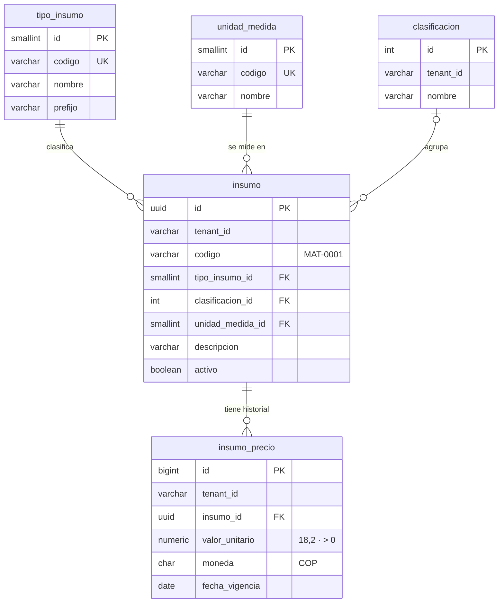
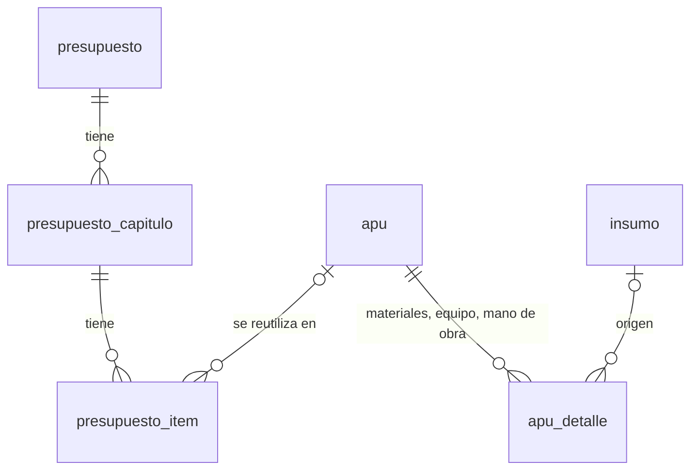

# Base de datos · Catálogo de insumos

Modelo PostgreSQL (13 o superior) creado a partir de `BASE DE DATOS PARA PRESUPUES-TEN.xls`. El archivo tiene tres hojas: MATERIALES, EQUIPO y MANO DE OBRA. Todas tienen las mismas columnas: descripción, unidad, valor unitario, fecha de actualización y clasificación.

## Instalación

```bash
createdb -U postgres infopresupuestal            # si no existe
psql -h localhost -U postgres -d infopresupuestal -f database/instalar.sql
psql -h localhost -U postgres -d infopresupuestal -v tenant=acme -f database/instalar.sql   # otro tenant
```

`instalar.sql` corre los cuatro scripts en una sola transacción: si algo falla, no queda nada a medias. Se puede volver a ejecutar sin duplicar datos. En **pgAdmin**, abre `scripts/01` a `scripts/04` en la misma pestaña del Query Tool y ejecútalos en orden. El tenant por defecto es `demo`. Para usar otro, ejecuta antes `SET app.tenant_id = 'acme';`.

| Script | Qué hace |
|---|---|
| `01_esquema.sql` | Crea los esquemas `presupuesto` (modelo) y `carga` (staging), las tablas, los índices, las restricciones y las vistas. |
| `02_catalogos.sql` | Carga los tipos de insumo y las 16 unidades de medida. |
| `03_carga_excel.sql` | Copia el Excel tal cual, como texto, a `carga.insumo_excel`. **Es un archivo generado.** |
| `04_normalizar_insumos.sql` | Limpia los datos de `carga` y los pasa a `presupuesto` para el tenant. |
| `05_apu_presupuesto.sql` | Crea las tablas de APU y presupuestos de obra (ver abajo). No carga datos. |

Si actualizas el Excel, regenera el script 03 con `pip install xlrd && python database/herramientas/xls_a_sql.py "<ruta>.xls"` y vuelve a ejecutar `instalar.sql`.

## Modelo



**Decisiones de diseño**

- **Tercera forma normal.** Las unidades, los tipos y las clasificaciones son catálogos, no texto repetido en cada fila.
- **Historial de precios.** El precio no es una columna de `insumo`: vive en `insumo_precio`, con una fila por fecha de vigencia. Un precio nuevo agrega una fila y nunca sobrescribe el anterior, así un presupuesto viejo conserva el precio con que se hizo. La vista `presupuesto.v_insumo_vigente` devuelve cada insumo con su precio más reciente.
- **Multi-tenant, igual que la API.** Cada tabla de negocio lleva `tenant_id`. Las llaves foráneas incluyen el tenant (`(tenant_id, clasificacion_id)` y `(tenant_id, insumo_id)`), así la base rechaza relacionar datos de dos tenants distintos. Los catálogos `tipo_insumo` y `unidad_medida` son globales.
- **Unicidad sin importar mayúsculas.** Un insumo es único por tenant, tipo, descripción y unidad, y la clasificación por tenant y nombre. Además cada insumo recibe un código legible por tenant (`MAT-0001`, `EQU-0001`, `MO-0001`), asignado en el orden del Excel.
- **Dinero en `numeric(18,2)`** con moneda `COP` (pesos colombianos, confirmado por el usuario). La columna `moneda` permite cargar otras monedas más adelante.
- **Búsqueda.** Un índice trigram (`pg_trgm`) sobre `descripcion` acelera `ILIKE '%tubo%'` y las búsquedas por similitud (`descripcion % 'tubo pvc 4'`).
- **Staging separado.** El Excel se copia sin cambios a `carga`, y las reglas de limpieza viven en la vista `carga.v_insumo_normalizado`. Así cualquier dato se puede rastrear hasta su hoja y fila de origen.

## APU y presupuestos de obra

`05_apu_presupuesto.sql` (PostgreSQL 15 o superior) modela las hojas **APU's** y **PRESUPUESTO** de `FORMATO PRESUPUES-TENV3v3.xlsm`. Para agregarlo a una base que ya tiene el catálogo:

```bash
psql -h localhost -U postgres -d infopresupuestal -f database/scripts/05_apu_presupuesto.sql
```

Si la API se conecta con un usuario distinto del dueño de las tablas, dale permisos:
`GRANT SELECT, INSERT, UPDATE, DELETE ON ALL TABLES IN SCHEMA presupuesto TO <usuario>; GRANT USAGE ON ALL SEQUENCES IN SCHEMA presupuesto TO <usuario>;`



| Tabla | Qué guarda | Reglas principales |
|---|---|---|
| `apu` | Actividad con su unidad (REPLANTEO por M2). Código `APU-0001` por empresa. | Descripción + unidad únicas por empresa. |
| `apu_detalle` | Líneas de las tres secciones en una tabla, con `tipo_insumo_id`. | `valor_parcial` es columna **generada** con la fórmula del Excel según el tipo. CHECK por columna (desperdicio 0–1, factor 1–3, rendimiento > 0). Si se borra el insumo de origen, la línea se conserva. |
| `presupuesto` | Obra, cliente, fecha, propuesta, estado (BORRADOR, APROBADO, ANULADO), % AIU, IVA sobre utilidad, duración y anticipo. Código `PRE-0001`. | Porcentajes como fracción entre 0 y 1. |
| `presupuesto_capitulo` | Capítulos numerados 1, 2, 3... | Número único dentro del presupuesto. |
| `presupuesto_item` | Ítem con consecutivo `capítulo.número` (1.1, 1.2), descripción, unidad, cantidad y valor unitario. | Guarda una **copia** del costo del APU al agregarlo: un presupuesto emitido no cambia solo si el APU cambia. `valor_total` es columna generada. Un APU usado no se puede borrar (`ON DELETE RESTRICT`). |

Todas las tablas llevan `tenant_id` y FK compuestas `(tenant_id, id)`, así una fila nunca apunta a datos de otra empresa. Las vistas `v_apu_costo` y `v_presupuesto_resumen` dan los totales (costo directo, AIU, IVA y valor total) con las mismas fórmulas que la API, para reportes en SQL.

## Resultado de la carga

| Tipo | Filas en Excel | Insumos | Con precio | Sin clasificación |
|---|---:|---:|---:|---:|
| Material | 3.879 | 3.694 | 3.678 | 491 |
| Equipo | 134 | 134 | 133 | 0 |
| Mano de obra | 47 | 47 | 47 | 0 |

Además se cargan 40 clasificaciones: las 39 de la columna N de MATERIALES más `EQUIPOS`.

**Reglas de limpieza** (`SELECT motivo, count(*) FROM carga.v_observacion GROUP BY motivo;` lista cada fila afectada):

| Motivo | Filas | Qué se hizo |
|---|---:|---|
| `DUPLICADO_MISMA_FECHA` | 184 | El mismo insumo (tipo, descripción y unidad) aparece repetido con la misma fecha, a veces con precios distintos. Se unifica en un solo insumo y se toma el precio **mayor**, el criterio conservador para presupuestar. |
| `DUPLICADO_OTRA_FECHA` | 171 | El mismo insumo aparece con fechas distintas. Se unifica y cada precio queda en el historial. |
| `SIN_CLASIFICACION` | 655 | La celda de clasificación está vacía. Si otra fila del mismo insumo la tiene, se usa esa; si no, el insumo queda sin clasificación (491 en total). |
| `PRECIO_CERO` | 16 | El precio es 0. Se crea el insumo sin precio. |
| `SIN_PRECIO` | 2 | El precio está vacío. Se crea el insumo sin precio. |
| `CLASIFICACION_INVALIDA` | 1 | En EQUIPO, `TABLERO O PLAQUETA…` tiene el número `201` como clasificación. Se usa `EQUIPOS`. |

También se quitan los espacios sobrantes de las descripciones (602 filas los tenían) y la hoja EQUIPO usa la clasificación oficial `EQUIPOS`.

## Siguientes pasos sugeridos

- **Análisis de precios unitarios (APU) y presupuesto:** `actividad` → `apu_insumo` (insumo, rendimiento, desperdicio) y `presupuesto` → `capitulo` → `item`. Las FK incluirían el tenant, igual que aquí.
- **Row Level Security** sobre `tenant_id` como segunda barrera, si la API fija `app.tenant_id` en cada conexión.
- **Clasificar** los 491 materiales sin clasificación desde la aplicación.
